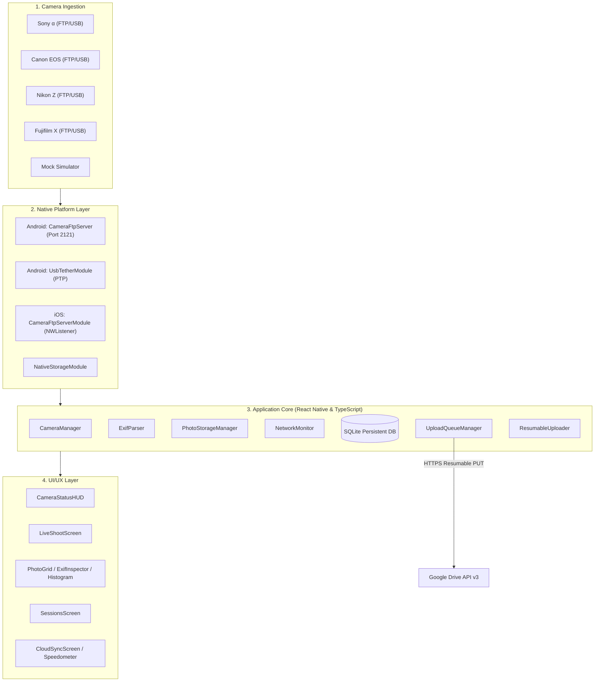
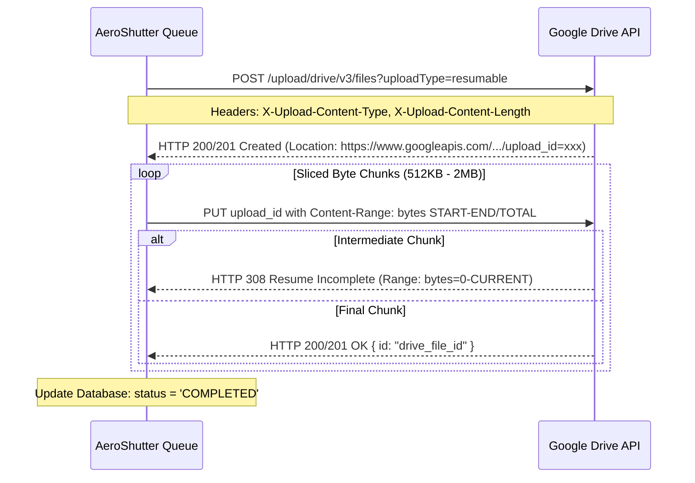

# AeroShutter Application Architecture

## 1. System Philosophy & Design Goals

AeroShutter is a professional cross-platform mobile application engineered to connect digital cameras (Sony, Canon, Nikon, Fujifilm) to smartphones, stream newly captured photos in real time, and automatically upload them to Google Drive without requiring a laptop or memory card swapping.

### Core Architectural Pillars
1. **Zero External Machine Dependency:** Operates fully standalone on mobile devices (Android and iOS).
2. **Multi-Protocol Camera Ingestion:**
   - **Embedded Wi-Fi FTP Server:** Zero-cable auto-transfer directly from modern camera firmware.
   - **USB-OTG PTP/MTP Direct Tether:** Sub-second wired transfer for high-volume studio shoots.
   - **Hot-Folder Storage Watcher:** Direct import from USB-C SD card readers.
   - **Mock Camera Simulator:** Built-in hardware simulator for testing, QA, and demos.
3. **Resilient Cloud Pipeline:** Official Google Drive v3 Resumable Upload protocol with automatic chunk slicing, byte offset recovery, and exponential backoff retry.
4. **Clean-Room Independent Implementation:** 100% original code without proprietary asset reuse or copyrighted materials.

---

## 2. Component Hierarchy & Flow

---

## 3. Data Ingestion & Storage Architecture

When a shutter click occurs on a connected camera:
1. **Ingestion Socket:** The camera firmware transmits the file via FTP `STOR` or USB PTP `GetObject`.
2. **Local Persistence:** The native module streams the byte buffer into app scoped storage:
   `Context.getExternalFilesDir()/Photos/DSC_XXXX.[ARW|CR3|NEF|JPG]`.
3. **EXIF Telemetry Extraction:** `ExifParser` parses TIFF/APP1 headers to extract shutter speed, aperture, ISO, focal length, camera model, and lens name.
4. **Database Record Creation:** A row is inserted into the SQLite `photos` table linked to the active `session_id`.
5. **Upload Enqueueing:** `UploadQueueManager` creates an entry in `upload_queue` with status `PENDING`.
6. **Reactive UI Dispatch:** Events update `LiveShootScreen`, instantly displaying the thumbnail and upload progress.

---

## 4. Google Drive Resumable Upload Specification

AeroShutter implements the Google Drive API v3 Resumable Upload protocol:

