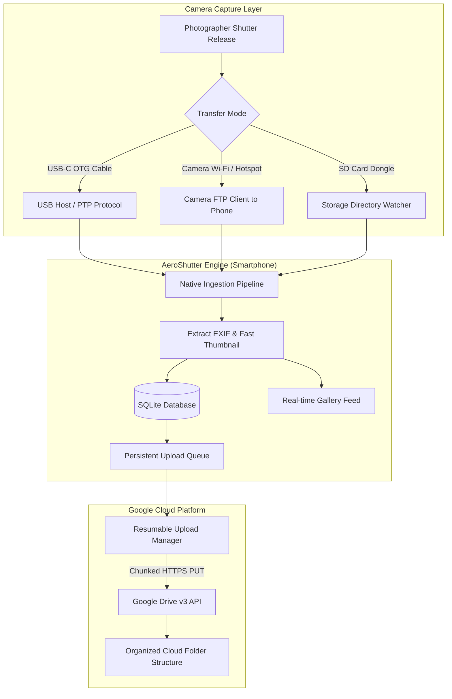
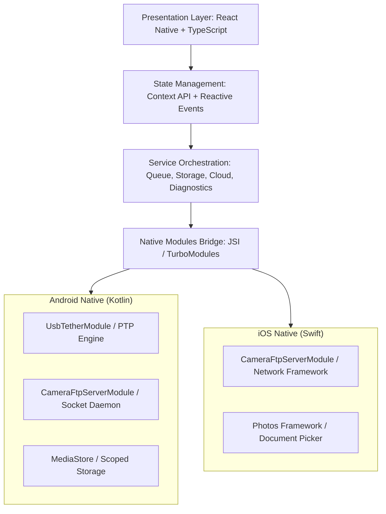

# Reverse Engineering Analysis & Technical Architecture Specification

**Project:** AeroShutter – Cross-Platform Real-Time Camera Tethering & Cloud Upload  
**Reference Application:** Satset – Realtime Photo Upload (`com.satsetmobile.max`)  
**Document Version:** 1.0.0  
**Compliance Standard:** Clean-Room Independent Implementation

---

## 1. Executive Summary & Legal Compliance

The reference application, **Satset – Realtime Photo Upload**, enables professional and event photographers to connect digital cameras (Sony, Canon, Nikon, Fujifilm) to an Android smartphone to stream newly captured photos instantly and upload them directly to Google Drive.

### Clean-Room Engineering Principles
To ensure complete legal compliance and intellectual property integrity:
1. **Zero Asset Copying:** No decompilation, binary copying, proprietary strings, artwork, icons, or visual assets are extracted or used.
2. **Protocol Standardization:** Camera communication utilizes public industry standards:
   - **USB PTP (Picture Transfer Protocol / ISO 15740)** and **MTP (Media Transfer Protocol)** via Android USB Host API (`android.hardware.usb`).
   - **RFC 959 (File Transfer Protocol)** over TCP/IP: Standard Wi-Fi background transfer protocol built natively into Sony Alpha, Canon EOS, Nikon Z, and Fujifilm X/GFX firmware.
   - **Standard File System Observers:** Standard OS directory change events (`FileObserver` / `DirectoryWatcher`).
3. **Legitimate Cloud Integrations:** Standard Google Drive REST API v3 using official OAuth 2.0 authorization flows and Google-sanctioned resumable upload protocols.
4. **Independent Cross-Platform Codebase:** Built completely from scratch using React Native, TypeScript, native Kotlin (Android), and native Swift (iOS).

---

## 2. Technical Analysis of Reference Application (Satset)

### 2.1 Publicly Observable Feature Set & User Flow


### 2.2 Functional Strengths of Reference Approach
1. **Elimination of Card Swapping:** Editors and clients can view high-resolution photos immediately on cloud drives seconds after the shutter click.
2. **Zero Bulky Equipment:** Replaces cumbersome laptop tethering stations with a pocketable mobile phone attached via a cold shoe mount to the camera.
3. **Dual Bandwidth Resilience:** Functions over smartphone cellular LTE/5G networks while the camera communicates via direct local Wi-Fi or USB.

### 2.3 Limitations in Original Reference App & Improvement Opportunities
| Reference Limitation | AeroShutter Architectural Solution |
| :--- | :--- |
| **Android-Only Support** | Cross-platform architecture: React Native UI + native Kotlin on Android + native Swift on iOS. |
| **Connection Drop Brittleness** | Automatic reconnect daemon with exponential backoff and socket keepalive heartbeat. |
| **RAW File Choking** | Intelligent chunked resumable upload engine (256KB-8MB slices) with checksum verification. |
| **Basic Metadata Inspection** | Full EXIF telemetry parser (ISO, Shutter, Aperture, EV, Focal Length, Camera Model, Lens, Color Profile, Histogram). |
| **Monolithic Storage** | ACID-compliant SQLite relational schema segregating Sessions, Photos, and Upload Queue Tasks. |
| **No Demo / Fallback Mode** | Integrated Mock Camera Simulator generating realistic sample burst shots and EXIF for offline testing. |

---

## 3. Independent System Architecture

### 3.1 Layered Architecture Overview


### 3.2 Camera Communication Protocols
1. **Embedded Wi-Fi FTP Server Protocol:**
   - Modern cameras (Sony A7 IV/A7R V/A1/A9 II, Canon EOS R5/R6/1D X Mark III, Nikon Z8/Z9/Z6 II, Fujifilm X-H2S) have a native FTP client in firmware.
   - AeroShutter spawns a local, non-root FTP daemon on `0.0.0.0:2121` with passive port range `2122-2130`.
   - The user creates an FTP profile on the camera pointing to the smartphone's Hotspot or local Wi-Fi IP.
   - Every photo taken automatically triggers an active/passive FTP `STOR` command, receiving the byte stream into the app sandbox.
2. **USB-OTG PTP / MTP Protocol:**
   - Android connects via `UsbManager` as USB Host.
   - PTP (Picture Transfer Protocol / ISO 15740) establishes connection, initiates session `0x1002`, registers for event interrupts `0x4000` (e.g., `ObjectAdded` event `0x4002`), reads object info, and retrieves full image buffers.
3. **Local Storage & SD Card Hot-Folder Watcher:**
   - Detects incoming files from external USB-C card readers or mounted storage paths using recursive file change notifications.

### 3.3 Google Drive Integration & Resumable Upload Engine
- **Auth Flow:** OAuth 2.0 with scopes `https://www.googleapis.com/auth/drive.file`.
- **Target Folders:** Automatic root folder `AeroShutter/` and sub-folders formatted as `[Session_Name]_[YYYY-MM-DD]`.
- **Chunked Resumable Uploads:**
  1. POST to `https://www.googleapis.com/upload/drive/v3/files?uploadType=resumable` with file metadata (name, mimeType, parent folder).
  2. Receives unique `Location` URI.
  3. Uploads file in sequential byte chunks with `Content-Range: bytes START-END/TOTAL`.
  4. Supports resumption after network interruptions by querying upload offset (`Content-Range: bytes */TOTAL`).

---

## 4. SQLite Database Schema Specification

```sql
-- Sessions Table
CREATE TABLE sessions (
    id TEXT PRIMARY KEY,
    name TEXT NOT NULL,
    description TEXT,
    drive_folder_id TEXT,
    drive_folder_url TEXT,
    is_active INTEGER DEFAULT 0,
    created_at INTEGER NOT NULL,
    updated_at INTEGER NOT NULL
);

-- Photos Table
CREATE TABLE photos (
    id TEXT PRIMARY KEY,
    session_id TEXT NOT NULL,
    file_name TEXT NOT NULL,
    local_path TEXT NOT NULL,
    thumbnail_path TEXT,
    file_size INTEGER NOT NULL,
    mime_type TEXT NOT NULL,
    is_raw INTEGER DEFAULT 0,
    width INTEGER,
    height INTEGER,
    exif_make TEXT,
    exif_model TEXT,
    exif_lens TEXT,
    exif_focal_length TEXT,
    exif_aperture TEXT,
    exif_shutter_speed TEXT,
    exif_iso INTEGER,
    exif_captured_at INTEGER,
    created_at INTEGER NOT NULL,
    FOREIGN KEY(session_id) REFERENCES sessions(id) ON DELETE CASCADE
);

-- Upload Queue Table
CREATE TABLE upload_queue (
    id TEXT PRIMARY KEY,
    photo_id TEXT NOT NULL,
    session_id TEXT NOT NULL,
    drive_folder_id TEXT NOT NULL,
    drive_file_id TEXT,
    status TEXT NOT NULL CHECK(status IN ('PENDING', 'UPLOADING', 'COMPLETED', 'FAILED', 'PAUSED')),
    progress_bytes INTEGER DEFAULT 0,
    total_bytes INTEGER NOT NULL,
    retry_count INTEGER DEFAULT 0,
    max_retries INTEGER DEFAULT 5,
    resumable_session_url TEXT,
    error_message TEXT,
    created_at INTEGER NOT NULL,
    updated_at INTEGER NOT NULL,
    FOREIGN KEY(photo_id) REFERENCES photos(id) ON DELETE CASCADE
);
```

---

## 5. Security & Privacy Guarantees
- **Local Storage Isolation:** Images and credentials stay in app-sandboxed directories (`Context.getExternalFilesDir()` / `Documents`).
- **Token Protection:** Secure encryption of OAuth refresh tokens using Android KeyStore and iOS Keychain.
- **Drive Scope Minimization:** Restricted to `drive.file` scope so the app can only view and manage files created by AeroShutter, preserving user privacy over existing cloud files.

